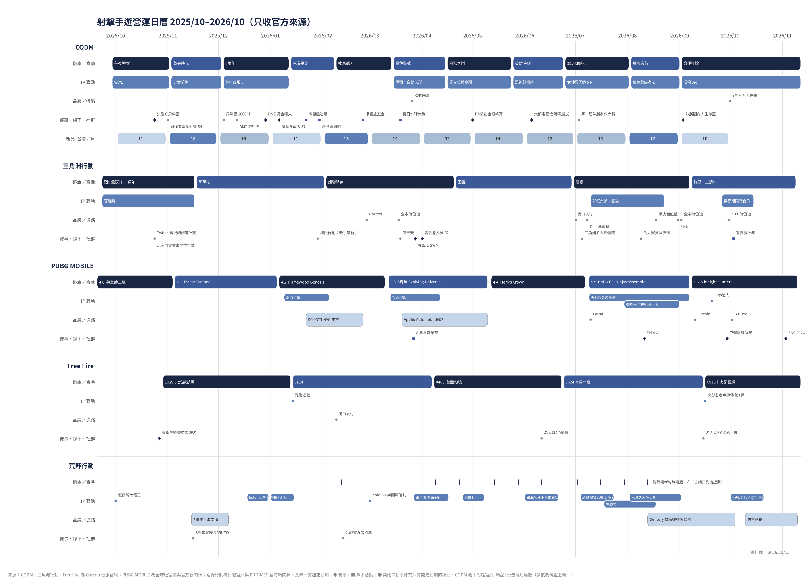

# 07 射擊手遊營運日曆：CODM 與競品（2025/10–2026/10）

把 CODM、三角洲行動、PUBG MOBILE、Free Fire、荒野行動近一年的版本、聯動、賽事、線下活動和看得到的變現活動排在同一條時間軸上，用來比較各家在營運方向上的不同選擇。只收有官方來源（官網公告或官方新聞稿）的項目，資料截至 2026/10/12。

- 原始資料：[`data/liveops_calendar_2025-10_2026-10.csv`](data/liveops_calendar_2025-10_2026-10.csv)（151 筆，每筆都有官方連結）
- 時間軸圖：[`img/liveops_calendar_2025-10_2026-10.png`](img/liveops_calendar_2025-10_2026-10.png)

**閱讀須知**

1. **各遊戲的來源區服不同。** CODM、三角洲行動、Free Fire 用 Garena 台服官網；PUBG MOBILE 用全球版官網和官方新聞稿；荒野行動用日服官網和 PR TIMES 上的官方新聞稿（日本是它的主要市場，台服內容可能不同）。
2. **官網發文量不等於活動量。** CODM 和三角洲的台服官網連每一檔抽獎都發公告，Free Fire 台服官網一年只發十幾篇，PUBG MOBILE 的官方新聞稿只寫大檔期。所以「活動密度」只適合拿 CODM 和三角洲（同一家發行商、同一種發文習慣）來比，其他遊戲看節奏和選擇就好。
3. 標「推論」的是作者根據日曆做的判斷，不是官方說法。

## 1. 一張表看各家的選擇

| | CODM | 三角洲行動 | PUBG MOBILE | Free Fire | 荒野行動 |
| --- | --- | --- | --- | --- | --- |
| 來源 | 台服官網 | 台服官網 | 全球版官網、官方新聞稿 | 台服官網 | 日服官網、官方新聞稿 |
| 大版本節奏 | 每 27–40 天一版，平均 34 天（12 個月 11 版） | 每 56–77 天一季，平均 70 天（6 季） | 每 58–65 天一版，平均 61 天（4.1–4.6）；每版都先開多輪公開 Beta（官網列出 2–4 輪） | 每 77–84 天一次大更新，平均 80 天（5 次） | 約每兩週一次例行更新 |
| 一年的聯動數 | 9 個 IP（11 版裡 9 版主打一個 IP）＋2 個在地品牌 | 3 個（奪魂鋸、彩虹六號、吳彥祖）＋8 次品牌或通路合作 | 12 個 IP、品牌或名人，一版常疊 2–4 個 | 2 個（咒術迴戰、火影回歸）＋街口支付 | 11 個 IP（7 個是「第 N 彈」或再登場）＋3 個實體品牌 |
| 聯動選什麼 | 歐美影視（WWE、哥吉拉與金剛、黑袍糾察隊、魔鬼終結者 2）＋日本與中國遊戲（少女前線、快打旋風 6、尼爾、女神異聞錄 5 R、崩壞 3rd） | 同類射擊遊戲（彩虹六號）、恐怖片、華人明星 | 全球級動漫和好萊塢（火影、咒術迴戰、一拳超人、蜘蛛人）＋時尚與車廠（SCHOTT NYC、Apollo、Ferrari、Lincoln）＋網紅與音樂人（MrBeast、Alan Walker） | 日本熱門動漫 | 日本動漫和 VTuber，大量回鍋 |
| 官網上看得到的變現 | 轉盤上新每月 10–18 篇（12 個月約 150 篇）、常有首周折扣；雙 11、周年、春節的儲值返利 | 每月 1–3 檔外觀抽獎、製造活動有保底；大量免費限時三角券；儲值里程；超商和蝦皮儲值送虛寶 | 新聞稿不談付費，強調免費贈品和邀請獎金 | 貴族鑽石（當月儲值累積，次月用在抽獎和通行證） | 殿堂轉蛋加半價券；邀好友送免費抽；聯動通行證；聯動期間儲值雙倍 |
| 社群與線下 | 揪團聚餐、紅包、旅遊金、水球大戰、樂園門票、零食聯名；創作者獎勵計畫 | 實況主陣營戰和台北線下賽、Twitch 創作者計畫、開放玩家自辦賽事 | 全球大型線下活動（埃及吉薩金字塔周年嘉年華、各國火影活動） | 名人堂 2.0 創作者計畫 | 實體通路（唐吉訶德、Suntory 自販機、海底撈）、澀谷戶外廣告、公認實況者 |
| 電競 | 在地盃賽（周年盃、冬季盃、生存盃）＋世界賽台港澳選拔 | PC 版小型盃賽（萬元獎金）＋國際賽資格 | 全球賽事（PMGC、PMWC 獎金 302.5 萬美元、亞運、Esports Nations Cup） | 台馬榮耀菁英盃 | 這次蒐集的官方新聞稿裡沒有賽事 |
| 周年慶檔期 | 10–12 月（2025/12 的 6 周年版本；2026/10 的 7 周年 × 可樂果） | 9 月（洲年慶） | 3 月（8 周年） | 6 月（9 周年） | 11 月（8 周年） |

## 2. 月曆矩陣

標籤：【版】大版本或賽季、【聯】IP 聯動或名人、【牌】品牌或通路合作、【賽】賽事、【下】線下或在地活動、【社】創作者或社群、【商】儲值和抽獎類活動、【免】免費發放付費貨幣。

| 月份 | CODM | 三角洲行動 | PUBG MOBILE | Free Fire | 荒野行動 |
| --- | --- | --- | --- | --- | --- |
| 2025/10 | 【版】午夜迴響（9/29 起，WWE） 【賽】6 周年盃 【商】CP 金庫 | 【版】烈火衝天＋一週年（9/23 起） 【聯】奪魂鋸（到 11/17） 【社】Twitch 創作者計畫、玩家自辦賽 | 4.0 萬聖節主題進行中 4.1 Beta 1–4 | 【賽】夏季榮耀菁英盃報名 【版】1029 火焰競技場 | 【聯】假面騎士電王再登場 |
| 2025/11 | 【版】黃金時代（11/03，少女前線） 【商】累儲加碼、決勝雙 11、台港澳儲值禮包 【社】創作者計畫 S4 預約 DMZ | 【版】阿薩拉（11/18） 反外掛系統升級 | 【版】4.1 Frosty Funland（11/05） PMGC 2025 場館 | — | 8 周年：【牌】海底撈（11/15–12/07）、發表 NARUTO 聯動 |
| 2025/12 | 【版】決勝 6 周年（12/04，DMZ 撤離行動上線、快打旋風 6） 【商】加倍返利 【社】DMZ 旅行團 【賽】DMZ 賞金獵人 | （賽季中） | 冬季節慶（12/12 起） 4.2 Beta 1–3 | 冰雪節（12/12） | 【聯】hololive 聖誕（12/18–31） |
| 2026/01 | 【版】冰海星淵（1/13，2026 S1 通行證） 【賽】冬季盃 S7 【下】揪團趣吃飯、決勝揪團節 | 新年活動 【社】增援行動：邀好友領紅包 | 【版】4.2 Primewood Genesis（1/06） 【聯】浴血黑幫（1/09–2/05） 【牌】SCHOTT NYC（1/22–2/25，歐美） | 【版】0114 更新 【聯】咒術迴戰 | 【聯】NARUTO（1/01–1/15）＋澀谷原宿戶外廣告 |
| 2026/02 | 【版】戎馬礪刃（2/09，春節） 【商】耗點返利、CP 金庫 【下】揪團旅遊金 20 萬 | 【版】蝶變時刻（2/03） 【商】儲值最高加贈 150% 新春行動（2/13–3/05） 【牌】Doritos | Skyhigh Spectacle 回歸 | 【牌】街口支付 | 【社】公認實況者招募 |
| 2026/03 | 【版】霧蝕警戒（3/15，尼爾） 【下】夏日水球大戰 【牌】浪我樂園 | 【賽】春戰盃 SWM（3/28–29） 【社】航天賽 【牌】全家儲值禮 | 【版】4.3 8 周年 Evolving Universe（3/12） 【聯】咒術迴戰（3/13–4/12）、MrBeast 【牌】Apollo 超跑（3/20–5/10） 【下】吉薩金字塔嘉年華（3/27） | — | 【聯】hololive 樂團篇（3/01）、東京喰種第 6 彈（3/27–4/17） |
| 2026/04 | 【版】困獸之鬥（4/16，哥吉拉與金剛） DMZ 刪檔結算 | 【版】回聲（4/21） 【賽】賞金獵人賽 S2 | 4.4 Beta 2–4 | 【版】0408 蒼藍幻境 | 【聯】彩虹社第 4 彈（4/25–5/08） |
| 2026/05 | 【版】「英雄」時刻（5/25，黑袍糾察隊） 【商】加倍返利 【賽】DMZ 出金巔峰賽得獎 | （賽季中） | 【版】4.4 Hero's Crown（5/12） | — | 例行更新 |
| 2026/06 | 【版】奪走你的心（6/25，女神異聞錄 5 R） 【賽】六都電競台港澳選拔（26 萬） | 【商】罪棘鐵冠、龐克搖滾抽獎 足球主題活動 【版】裂變（6/30） | Dinoground 回歸 4.5 Beta 1–3 | 【版】0624 9 周年 【社】名人堂 2.0 招募 | 【聯】BLEACH 第 2 彈（6/01–6/21） |
| 2026/07 | 【社】第一屆決勝創作大賞 【商】P5R 轉盤、組隊消費返利 725 成為怪盜傳說 | 【聯】彩虹六號（7/10–8/23） 【社】名人陣營戰＋台北線下賽 【牌】街口、7-ELEVEN 【免】2600 限時三角券 先鋒測試服 | 【版】4.5 NARUTO（7/09） 【牌】Ferrari 【聯】蜘蛛人（7/30–9/01） | — | 【聯】EVA 第 8 彈（7/04–7/24）、伊藤潤二（7/18–8/18） |
| 2026/08 | 【版】搞鬼夜行（8/03，魔鬼終結者 2） 【商】3500 限時 CP、組隊儲值同享 安卓體驗服 | 【免】寶藏月 2600 限時三角券 【商】儲值里程；黑海、北極星、青花抽獎 【社】名人寶藏探險隊 【牌】蝦皮、芬達 | 【賽】PMWC 巴黎（8/11–16） PUBG MOBILE LIGHT 預告 | — | 【聯】鬼滅之刃第 2 彈（8/02–9/02） 【牌】Suntory 自販機（8/13–10/04） |
| 2026/09 | 【版】命運征途（9/02，崩壞 3rd） 【賽】決勝圈內人生存盃 【商】律者轉盤、CP 金庫 | 【版】群星＋二週年（9/08） 【聯】吳彥祖（9/26–10/15） 【免】至少 3,900 限時三角券 【牌】全家、7-ELEVEN | 【版】4.6 Midnight Hunters（9/08） 【牌】Lincoln 【聯】一拳超人 【賽】亞運電競決賽 Ocean Odyssey 回歸、4.7 Beta | 【版】0916 更新 【聯】火影回歸 【社】名人堂 2.0 網站 | （Suntory 持續） |
| 2026/10（到 10/12） | 【牌】7 周年 × 可樂果 | 【商】頻段弧閃抽獎 【下】寧夏慶洲年 1v1 模式上線 | 【牌】B.Duck 4.7 Beta 2 （11/03–08 Esports Nations Cup） | — | 【聯】Fate HF 第 2 彈（10/01–10/21） 【牌】唐吉訶德（10/10–11/10） |

## 3. 營運方向的不同選擇

### 3.1 內容節奏：四種打法

- **CODM：每月一個版本、每版一個 IP。** 11 個版本平均 34 天一版，其中 9 版主打一個外部 IP。玩家每個月都有一個新話題，但每次聯動只有一個版本的壽命。
- **PUBG MOBILE：兩個月一個「主題模式」，再往裡面疊聯動。** 每版的主角是自家原創的主題模式（企鵝村、樹人森林、希臘神話、吸血鬼），聯動是疊在上面的配件：4.5 版同時有火影、Ferrari、蜘蛛人，4.6 版同時有 Lincoln、一拳超人、B.Duck、Alan Walker。熱門主題模式還會回歸（Skyhigh Spectacle、Dinoground、Ocean Odyssey）。
- **三角洲行動：兩個多月一季，靠玩法內容撐。** 每季的公告重點是新地圖、新探員、新武器和新系統，聯動一年只有 3 個。季中再用抽獎、免費貨幣、節慶活動和通路合作維持熱度。
- **荒野行動：聯動幾乎不中斷地輪播。** 2026/3 到 10 月幾乎每個月都有 2–4 週的聯動檔，9 個有起訖日的聯動平均 21 天，常常前一檔還沒結束下一檔就開始（7 月 EVA 和伊藤潤二重疊、8 月鬼滅和 Suntory 重疊）。
- **Free Fire：大更新間隔最長（約 80 天），重點放在玩法系統。** 台服官網的更新日誌大多在講模式、角色和武器平衡，一年只有咒術迴戰和火影兩個大型聯動。

### 3.2 聯動選什麼：反映各自的玩家輪廓（推論）

- **CODM 的聯動一半是歐美影視、一半是日中遊戲。** 歐美影視（WWE、哥吉拉與金剛、黑袍糾察隊、魔鬼終結者 2）和 Call of Duty 的軍武、好萊塢形象一致；少女前線、尼爾、女神異聞錄 5 R、崩壞 3rd 這類日本或中國遊戲則是對準台灣的 ACG 玩家。兩條線交替，代表 CODM 想同時抓「射擊核心玩家」和「二次元玩家」。
- **PUBG MOBILE 選的是全球都認得的 IP 和生活品牌。** 火影、蜘蛛人、Ferrari、MrBeast 這類合作的目的比較像品牌曝光和全球行銷，而且會分區操作（SCHOTT NYC 只在歐美上）。
- **荒野行動靠回鍋。** 11 個 IP 聯動裡有 7 個是「第 N 彈」或再登場（EVA 已到第 8 彈、東京喰種第 6 彈）。回鍋聯動的好處是 IP 方合作成本較低、老玩家有收藏動機，代價是新鮮感有限，所以它另外用 NARUTO、伊藤潤二這類新 IP 和實體通路補話題。
- **三角洲行動很少做外部 IP，改用明星和通路。** 二週年請吳彥祖、平常跟 Doritos、芬達、7-ELEVEN、全家、蝦皮合作，這些合作比較偏「把遊戲放進玩家日常消費場景」，而不是靠 IP 吸新粉。

### 3.3 變現節奏：抽獎密度與門檻（只比 CODM 和三角洲）

- **CODM 的商城是高頻小檔。** 官網「[新品]」公告 12 個月約 160 篇，其中約 150 篇是轉盤上新，等於每週約 3 個新轉盤；至少 26 篇標題寫明折扣（例如首周 85 折、七折）。另外在雙 11、周年慶、春節前後集中推儲值返利（累儲加碼、加倍返利、CP 金庫）。
- **三角洲行動是低頻大檔，加上大量免費貨幣。** 官網的抽獎公告大約每月 1–3 檔，製造類活動有明確保底（挽歌 90 次、飛虎-威龍 50 次）。最明顯的手法是先送玩家可以拿去抽獎的限時三角券：2026/7/29 和 8/05 各 2,600、二週年至少 3,900。限時三角券不能買通行證和市場商品（官方 2025 週年公告寫明），等於用免費額度把玩家帶進抽獎系統。
- **兩種做法的差異（推論）：** CODM 用「選擇多＋首周折扣」讓不同喜好的玩家都找得到想買的東西；三角洲用「免費額度＋保底」降低第一次付費的心理門檻。CODM 的風險是轉盤太多造成疲乏和稀釋單檔收入，三角洲的風險是免費額度養成玩家「等送」的習慣。

### 3.4 社群、線下與在地化

- **CODM 最「在地」。** 揪團吃飯、紅包、旅遊金、夏日水球大戰、浪我樂園門票優惠、可樂果包裝，都是只在台灣做得出來的活動，重點是讓玩家揪朋友一起玩。
- **三角洲靠實況主。** 名人陣營戰、名人寶藏探險隊、航天賽、Twitch 創作者計畫，社群經營的槓桿放在實況主身上，符合撤離射擊「好看、適合直播」的特性。
- **PUBG MOBILE 做全球大秀。** 吉薩金字塔嘉年華、巴黎 PMWC 是品牌等級的活動，台灣玩家感受到的主要是遊戲內內容。
- **荒野行動走實體通路。** 唐吉訶德、Suntory 自販機、海底撈都附遊戲內序號，把實體消費和遊戲獎勵綁在一起；它也常把「邀 3 位好友」設成拿免費服裝和抽獎的條件（BLEACH、EVA、Fate）。

### 3.5 玩法正在互相靠近

- **CODM 在 2025/12 推出 DMZ 撤離行動**，直接進入三角洲「烽火地帶」的撤離射擊領域；2026/4 發布了 DMZ 刪檔結算公告。
- **三角洲在 2026/9–10 加入黑潮爆破和 1v1 模式**，往 CODM 和 CS 類的快節奏對戰靠。
- 兩款都是 Garena 台灣代理，玩法重疊越多，同公司內部搶同一群玩家的時間和預算的風險就越高（推論）。

### 3.6 周年慶檔期錯開，但第四季最擠

PUBG MOBILE 在 3 月、Free Fire 在 6 月、三角洲在 9 月、荒野行動在 11 月、CODM 在 10–12 月。對 CODM 來說，9–12 月要同時面對三角洲的洲年慶、荒野的周年、雙 11 和自己的周年慶，是全年最擠的一段。

## 4. 對 CODM 的啟示（推論，可用在面試）

1. **IP 頻率已經很高，下一步是提升每檔 IP 的效率。** 可以參考荒野行動的兩個做法：把表現好的 IP 做成系列回鍋（有收藏動機），以及把「邀好友組隊」設成拿免費聯動獎勵的條件，讓聯動同時負責拉新。
2. **降低第一次付費的門檻。** CODM 用首周折扣，三角洲用免費限時貨幣加保底。可以用 A/B 測試比較兩種方式對首儲率和 ARPPU 的影響。
3. **補上通路合作。** 三角洲幾乎每月都有超商或蝦皮的儲值送虛寶；這次只檢查了 CODM 官網公告的標題，沒有看到同類合作。通路合作可以接觸不在社群上的玩家，也能分散 App Store 和 Google Play 的抽成。
4. **和三角洲做區隔。** DMZ 和烽火地帶重疊，建議 CODM 的 DMZ 主打「CoD IP＋短時間一局」，不要和三角洲比硬核程度；同時錯開兩款遊戲的大型活動檔期。
5. **電競維持在地盃賽加世界賽選拔的組合。** PUBG MOBILE 的全球賽事規模學不來，CODM 現在的在地盃賽（獎金 15–26 萬元）適合當社群活動和新秀管道。

## 5. 逐款事件清單

每一筆事件的日期、說明和官方連結在 [`07b_liveops_events.md`](07b_liveops_events.md)，也可以直接用 CSV。

## 6. 資料怎麼蒐集、有哪些限制

- **CODM：** 讀取 codm.garena.tw 新聞列表的全部 450 篇，取 2025/9/29 之後的公告；「[新品]」篇數按官網列表日期計算。
- **三角洲行動：** 官網 system、event、announcement 列表各只顯示最近約 20 篇，2025/11–2026/5 的賽季公告是用搜尋找到官方頁面補上的，所以這段期間的抽獎類公告可能沒收齊。
- **PUBG MOBILE：** 版本日期來自 pubgmobile.com 英文版公告列表（48 篇）；內容來自代理公關公司（Swipe Right、Games Press）發布的官方新聞稿。官網公告內文無法讀取，4.2、4.3 的主題名稱和聯動日期來自媒體轉載的官方新聞稿；4.4 的「Hero's Crown」來自日本代理商 KRAFTON JAPAN 公告的媒體報導（[gamebiz](https://gamebiz.jp/news/425756)）。台服沒有獨立官網，全球版內容不一定和台灣同步。
- **Free Fire：** ff.garena.com 台服新聞列表一年只有十幾篇，遊戲內和粉絲專頁的活動沒有收錄。
- **荒野行動：** 日服官網（knivesout.jp）和 NetEase Interactive Entertainment 在 PR TIMES 發的新聞稿，台服活動可能不同；日服官網只列出近期的例行更新。
- **暗區突圍：** 這次沒有收錄。
- 全部連結在 2026/10/12 讀取。
